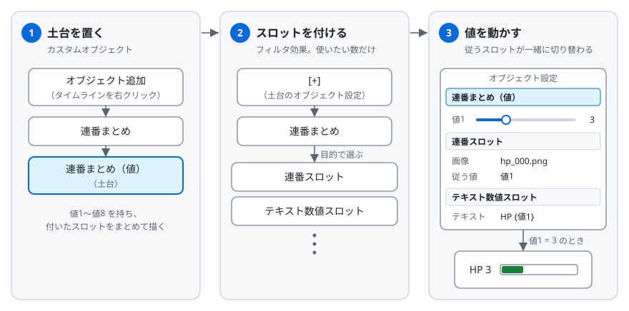

# 連番まとめ（AviUtl2 スクリプト）

AviUtl2 用のスクリプトです。

- **連番まとめ**: 複数の連番画像を1つのオブジェクトにまとめ、値で一括して切り替えます。

<picture>
  <source media="(prefers-color-scheme: dark)" srcset="docs/images/usage-dark.svg">
  
</picture>

## 動作環境

- AviUtl ExEdit2 v2.1.17 以降

## 導入

`script/` フォルダのファイルを、AviUtl2 の Script フォルダ（例：`C:\ProgramData\aviutl2\Script`）に置きます。
くわしくは Wiki の [導入](https://github.com/osakanamaki/renban-matome/wiki/導入) を参照してください。

## 最初の一歩

1. 「オブジェクト追加」→「連番まとめ」→「連番まとめ（値）」を置きます。
2. オブジェクト設定の [+] →「連番まとめ」から「連番スロット」を追加し、「画像」に連番の画像（例：`hp_000.png`）を指定します。
3. 土台の「値1」を動かすと、画像が切り替わります。

## 使い方

土台とスロットの項目、計算式の書き方、作例、困ったときは [Wiki](https://github.com/osakanamaki/renban-matome/wiki) にまとめています。

| 部品 | 役割 |
|---|---|
| [連番まとめ（値）](https://github.com/osakanamaki/renban-matome/wiki/連番まとめ（値）) | 土台。「値」を8つ持ち、付いたスロットをまとめて描く |
| [連番スロット](https://github.com/osakanamaki/renban-matome/wiki/連番スロット) | 値の番号の連番画像を表示する |
| [連番スロット（ゲージ）](https://github.com/osakanamaki/renban-matome/wiki/連番スロット（ゲージ）) | 値を「ゲージの上限」に対する割合で、HP バーなどの連番画像に割り振る |
| [連番スロット（計算式）](https://github.com/osakanamaki/renban-matome/wiki/連番スロット（計算式）) | 表示する番号を計算式で決める |
| [テキスト数値スロット](https://github.com/osakanamaki/renban-matome/wiki/テキスト数値スロット) | 値を文字で表示する |
| [連番スロット（複製並べ）](https://github.com/osakanamaki/renban-matome/wiki/連番スロット（複製並べ）) | 1つの画像を、値で決まる数だけ並べる |

## 開発

開発環境の作り方は [docs/development.md](docs/development.md)、要件は [requirements.md](requirements.md) を参照してください。

## ライセンス

[MIT License](LICENSE)
