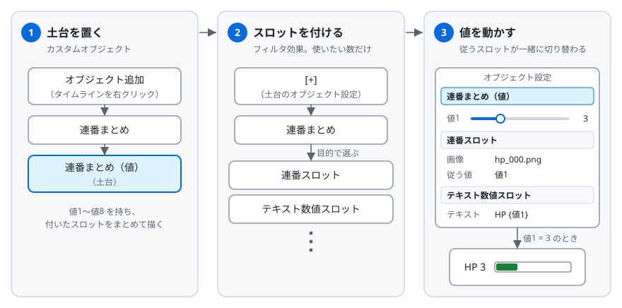

連番まとめ（AviUtl2 スクリプト）の使い方の Wiki です。

> 対象：v0.3.0
>
> このWikiは準備中です。

## 連番まとめでできること

複数の連番画像を1つのオブジェクトにまとめ、値で一括して切り替えます。
HP・MP のような状態表示を、1つのレイヤーで作れます。

## しくみ

連番まとめは、「土台」と、土台に付ける「スロット」を組み合わせて使います。

| 部品 | 種類 | 役割 |
|---|---|---|
| [連番まとめ（値）](連番まとめ（値）) | カスタムオブジェクト（土台） | 「値」を8つ持ち、付いたスロットをまとめて描く |
| [連番スロット](連番スロット) | フィルタ効果 | 連番画像を1つ受け持ち、値の番号の画像を表示する |
| [連番スロット（計算式）](連番スロット（計算式）) | フィルタ効果 | 表示する番号を計算式で決める |
| [テキスト数値スロット](テキスト数値スロット) | フィルタ効果 | 値を文字で表示する |
| [連番スロット（複製並べ）](連番スロット（複製並べ）) | フィルタ効果 | 1つの画像を、値で決まる数だけ並べる |

## ページの一覧

- [導入](導入)
- 土台：[連番まとめ（値）](連番まとめ（値）)
- スロット：[連番スロット](連番スロット)、[連番スロット（計算式）](連番スロット（計算式）)、[テキスト数値スロット](テキスト数値スロット)、[連番スロット（複製並べ）](連番スロット（複製並べ）)
- [計算式の書き方](計算式の書き方)
- [作例](作例)
- [Tips](Tips)
- [困ったとき](困ったとき)
